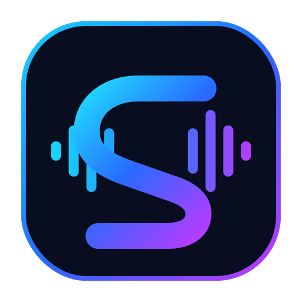

<p align="center">
  
</p>

<h1 align="center">SyncWave</h1>

<p align="center">
  <strong>Synchronized multi-device audio routing for Windows 10 &amp; 11.</strong><br/>
  Watch movies in VLC, stream YouTube, or listen to Spotify across wired speakers and multiple Bluetooth earphones at the exact same time &mdash; in sync, with independent hardware volume per listener.
</p>

<p align="center">
  
  
  
</p>

---

## Download & Install (Windows)

1. Go to the **[Releases](https://github.com/ak4cse/SyncWave/releases)** page and download **`SyncWave-Setup-1.0.0.exe`**.
2. Double-click **`SyncWave-Setup-1.0.0.exe`** to install SyncWave.
   - *If Windows SmartScreen appears (because the binary is self-published), click **More info** &rarr; **Run anyway**.*
3. Launch **SyncWave** from your **Desktop** shortcut or **Windows Start Menu**.

> **No manual Windows Sound setup required:** SyncWave automatically routes your system audio when you click **Start Sync** and restores your normal default speaker/headphones when you click **Stop** or close the app.

---

## Why SyncWave?

### The Problem
Trying to watch a movie or video on one laptop with friends — where one person uses wired speakers or headphones and another uses Bluetooth earbuds — breaks on Windows out of the box:
1. **Single-output limit**: Windows only sends audio to one default playback device at a time.
2. **Bluetooth echo & lag**: Even with virtual audio cables, Bluetooth A2DP earbuds have ~150–250 ms of wireless transport and DSP delay compared to wired speakers, causing an unbearable echo.
3. **Clock drift & shared volume**: Separate audio hardware clocks drift out of sync over a 2-hour movie, and Windows gives no simple way for each listener to set their own comfortable hardware volume.

### Our Solution
**SyncWave** combines a real-time C++20 WASAPI audio engine with a modern WebView2 desktop app:
- **One-Click System Audio Sync**: Automatically switches Windows' default playback device to a loopback carrier on **Start Sync**, captures everything playing on your PC (VLC, Chrome, YouTube, Netflix, Spotify), and automatically restores your original default device on **Stop** or exit.
- **Independent Hardware Volume (`0%–100%`)**: Controls each device's true Windows `IAudioEndpointVolume` master level independently of system sound (defaults to a safe **50%** on first launch and remembers your exact levels next time).
- **Live Per-Device Sync Delay (`0–400 ms`)**: Lock-free circular `DelayBuffer` lets you delay wired speakers smoothly in real time until they lock with Bluetooth earphones.
- **Closed-Loop Clock Drift Correction**: Continuously estimates each hardware clock (`DeviceClock` + `FilteredDriftEstimator`) and applies slew-limited sinc micro-resampling (`±100 ppm`) so outputs stay locked for hours.
- **Customizable Studio UI**: Switch between **Brutalist**, **Studio**, or **Minimal** UI styles in **AMOLED Dark** or **Crisp Light** mode, with a friendly built-in quick-start guide and an optional collapsible diagnostics drawer.

---

## How to Use

1. **Turn ON everyone's speakers or earbuds** in SyncWave (each starts at 50% hardware volume).
2. **Click `Start Sync`** and play your movie or music in **VLC**, **YouTube**, **Netflix**, or **Spotify**.
3. **Hear an echo?** Slowly slide **Sync Delay** up on the *wired speaker* until both ears lock together.
   - *Watching in external VLC?* Press **`J`** in VLC to shift audio ahead by the recommended offset shown in SyncWave so mouths on screen match the audio.

---

## Building from Source & Creating the Installer

### Prerequisites (Windows x64)
- **MSYS2 UCRT64** (`cmake`, `ninja`, `g++` C++20, `mingw-w64-ucrt-x86_64-webview2-loader`)
- **Inno Setup 6** (`winget install JRSoftware.InnoSetup`)
- **Edge WebView2 Runtime** (pre-installed on Windows 10/11)
- **VLC 64-bit** (`C:\Program Files\VideoLAN\VLC`)

### Build & Run Tests
```powershell
$env:PATH = "C:\Program Files\VideoLAN\VLC;C:\msys64\ucrt64\bin;$env:PATH"
cmake -B build -G Ninja -DCMAKE_BUILD_TYPE=Release
cmake --build build --config Release
.\build\syncwave_tests.exe
```

### Build Windows Installer (`SyncWave-Setup-1.0.0.exe`)
```powershell
powershell -ExecutionPolicy Bypass -File .\installer\build_installer.ps1
```
Outputs `dist\SyncWave-Setup-1.0.0.exe` with all runtime DLLs, Desktop/Start Menu shortcuts, app icon, and a clean Windows uninstaller.

---

## Project Structure
- `assets/` — Brand logo (`syncwave.ico`, `syncwave-icon.svg`, `syncwave-icon-512.png`, `syncwave-icon-1024.png`)
- `src/audio/` — `MasterAudioBus`, `OutputRouter`, `DeviceOutput`, `AudioEngine`, `RingBuffer`
- `src/sync/` — `DeviceClock`, `FilteredDriftEstimator`, `SyncController`, `DelayBuffer`, `AcousticCalibrator`
- `src/dsp/` — `Resampler`, `ChirpGenerator`, `CorrelationDetector`
- `src/windows/` — `DeviceManager`, `WasapiOutput`, `WasapiCapture`, `DefaultAudioSwitcher`, `EndpointVolumeController`
- `src/av/` — `VlcMediaEngine`, `TimelineModel`
- `src/core/` — `ISyncWaveEngine`, `SyncWaveEngineImpl`, `DiagnosticsSnapshot`
- `src/gui/` — WebView2 native host (`MainWindow.h/.cpp`), embedded UI (`StudioUiHtml.h`), Windows icon resource (`app.rc`)
- `src/app/` — CLI interface (`syncwave.exe`)
- `installer/` — Inno Setup 6 script (`SyncWave.iss`) & packaging script (`build_installer.ps1`)
- `tests/` — Automated unit & integration test suite (`syncwave_tests.exe`)

---

## Credits

Developed by **Ankush** ([ak4cse](https://github.com/ak4cse)).
